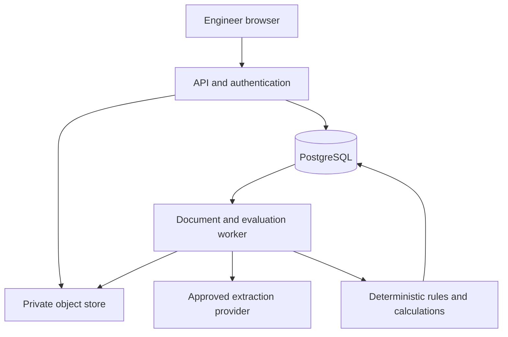

# BidFit master system blueprint v1.0
18 October 2026 • Development specification • Phase 1 limited prototype

## Product decision
Build a standalone, invite-only RFQ screening application. The first release accepts synthetic English text PDFs and TXT, extracts tag requirements with sources, lets an engineer resolve extraction issues, executes approved screening rules and exports a traceable report. Missing product data remains visible. A successful demo may legitimately return INSUFFICIENT DATA. Do not manufacture GO results to demonstrate progress.

Two-week scope: authentication, projects, multiple pump tags, upload, page-preserving extraction, rule-driven technical screening, separate manual commercial assessment, engineer disposition, immutable audit and HTML/JSON/CSV exports. Basic scanned-PDF OCR is a stretch item with an explicit unsupported state if unavailable. DOCX/XLSX/ZIP, Arabic OCR, complex tables, drawings and hydraulic size selection are outside the committed prototype. Mark excluded relevant files as coverage gaps. They cannot silently disappear from an evaluation.

## Architecture choice and tradeoffs
| Component | Selection | Rationale and alternative |
|---|---|---|
| UI | React + TypeScript + Vite, router and typed API client | Authenticated workflow has no immediate SEO/SSR need. Next.js is suitable later if server rendering/BFF is required, but adds a Node service now |
| API | FastAPI, Pydantic, SQLAlchemy, Alembic | Python engineering libraries; modular typed contracts and migrations |
| Execution | Same Python codebase, separate worker process | Durable PostgreSQL jobs; avoid in-process background tasks for expensive work |
| State | Managed PostgreSQL | Transactions, relational evidence, immutable snapshots; JSONB for source payloads |
| Files | Private S3-compatible object store | Originals and derived artifacts separated; short-lived authorized downloads |
| Auth | Managed OIDC provider using authorization code + PKCE | Invite-only identities; backend session cookie; no home-made password service |
| Parsing | pypdf/pdfplumber, evaluated against fixtures | Preserve page/location. Review dependency licenses before release; avoid assuming all PDF libraries permit proprietary distribution |
| OCR | Adapter, disabled by default; local OCR or approved service | No confidential upload to an unapproved provider; page coverage recorded |
| LLM | Provider-neutral structured extraction adapter | Environment-configured model, prompt version and budget; deterministic fake adapter for tests |
| Search/RAG | PostgreSQL text search first | Retrieval assists evidence lookup. No vector database or agent orchestration needed for MVP |
| Delivery | Docker API/worker; static UI served behind same-origin reverse proxy | Managed database/object store; no Kubernetes or microservice fleet |
| Source control | Private Git repository, CI and pinned dependency lockfiles | Code only; no RFQs, secrets or unrestricted product data in Git |

These are design choices informed by official documentation [T1–T3], not vendor promises of BidFit performance. Hosting choice is contingent on company-approved region, DPA, retention and service suitability.



## User journeys and screens
1. Sign in: invite required; unauthorized users cannot enumerate projects. Roles: Admin, Engineer, Commercial, Viewer. Engineering rule approval requires designated engineering permission, not merely infrastructure Admin.
2. Dashboard: show project owner, ingestion progress, tag decisions, unresolved issues, evaluation freshness and last review. No overall “ready” badge while mandatory files fail parsing.
3. Project: client/reference, classification, currency (commercial only), project frequency, document manifest and tag register. Upload revisions are new document versions, never overwrites.
4. Evidence review: left source viewer; right raw/normalized facts with tag, units, locations, uncertainty and contradiction indicators. Engineer may accept, correct or mark N/A with justification. A correction preserves original extraction.
5. Evaluation: per-tag outcome, coverage, rule results and evidence. Separate tabs for technical and commercial assessment. Expand each finding to RFQ requirement, capability source, rule version, calculation and action.
6. Clarifications/deviations: owner, customer-facing question, due date, resolution source and acceptance status. Draft text only; no automatic email submission.
7. Review: engineer signs a frozen evaluation. Management records final participation decision independently. A failed non-waivable mandatory constraint cannot be waived by a favorable commercial score.
8. Export: report revision, immutable snapshot IDs, sources, missing inputs, assumptions, rule results and human disposition. “Preliminary screening” clearly distinguishes the report from a certified selection.

## Ingestion pipeline
UPLOAD_PENDING → QUARANTINED → VALIDATED → PARSING → EXTRACTING → NEEDS_REVIEW → READY_FOR_EVALUATION. FAILED/PARTIAL/CANCELLED are explicit terminal or recoverable states. File limits proposed for prototype: 25 MiB/file, 20 files/project and 500 pages/project; configurable operational controls, not engineering limits.

Check actual file signatures, extension allowlist, malware scan, parser resource limits and encrypted-file rejection. Generate object keys server-side. Do not fetch external links embedded in documents. A document is untrusted data, including any instructions it contains. Extraction cannot execute tools, change rules or grant permissions.

Persist original SHA-256, page count, parser version and per-page quality. Classify RFQ/MR/datasheet/specification/BOQ/offer/reference/unknown. Offers and historical selections are not current customer requirements. Extract each relevant tag with requirement modality (mandatory/preferred/informative), edition, source and text span. Detect shared requirements but do not merge tags. Unassigned facts require review.

LLM response is schema-validated. Citations must reference real page IDs and matching source text; unsupported citations are rejected. Store raw extraction and validate numbers/units separately. A model cannot create capability records. Conflict resolution uses an engineer-approved document precedence matrix; latest upload time alone has no authority. Preserve both competing facts until resolved.

## Fact and result contract
```json
{
  "tag_id":"P-101", "field":"rated_flow", "raw_value":"100",
  "raw_unit":"m3/h", "normalized_value":0.0277777778,
  "normalized_unit":"m3/s", "basis":"rated",
  "status":"PROPOSED", "mandatory":true,
  "source":{"document_version_id":"uuid","page_index":3,"printed_page":"2","span_id":"uuid"},
  "quality":{"method":"text","warnings":[],"human_verified":false}
}
```
Page index is one-based physical PDF page. TXT uses line ranges. Printed labels are additional metadata. Evidence of the requirement, evidence of capability and rule authority are three separate links.

```json
{
  "criterion_id":"T08", "result":"UNKNOWN", "severity":"BLOCKER",
  "reason_code":"NPSH_BASIS_MISSING", "fact_ids":["uuid"],
  "capability_version_ids":[], "rule_version_id":"uuid",
  "calculation":null, "clarification":"Confirm available NPSH and datum at maximum temperature.",
  "decision_impact":"INSUFFICIENT DATA"
}
```
LLM confidence is optional diagnostic metadata, never a gate. Numeric comparisons use validated evidence and approved tolerances. Extraction quality labels are proposed/verified/conflicting/unreadable, not invented calibrated certainty.

## Decision algorithm (normative)
Rule-level results: PASS, FAIL, UNKNOWN, NOT_APPLICABLE. Each has applicability evidence, severity, waiver policy and coverage effect. Rules in DRAFT cannot issue engineering conclusions; a required draft rule contributes UNKNOWN. Test rules execute only in an isolated synthetic namespace.

Candidate-level failure eliminates that candidate only. Tag-level NO-GO requires either a confirmed project-wide prohibition or complete, current, engineering-approved search scope with every permitted solution failing a mandatory non-waivable requirement. Empty database/search results never prove this.

For each tag, apply ordered logic:
1. Confirmed non-waivable project prohibition or exhaustive approved alternative failure → NO-GO, retaining other unknowns in the report.
2. Any unresolved decision-critical fact, applicability, conflict, required inactive rule, missing capability or processing coverage → INSUFFICIENT DATA.
3. Remaining explicit waivable deviations or noncritical verification actions → CONDITIONAL GO, each with owner and closure requirement.
4. All applicable mandatory criteria positively checked against valid evidence and minimum screening coverage satisfied → GO (preliminary only).

Project roll-up assumes a complete-package bid by default: any required tag NO-GO → project NO-GO; otherwise any INSUFFICIENT DATA → that result; otherwise CONDITIONAL GO; otherwise GO. If partial lots are explicitly permitted, management may choose an eligible subset, while excluded tag outcomes remain visible. Never average away a failed tag. Evaluate alternatives against the same requirement snapshot.

Commercial criteria remain manual until the actual GOAL checklist is supplied. No invented official weights. Store per-criterion rationale and a provisional custom score only if explicitly approved. Final participation decision can decline a technically eligible opportunity. It cannot label a technically prohibited scope eligible.

Overrides append an adjudication record (old/new disposition, actor, reason, evidence, scope and timestamp), preserving computed result. Evidence corrections or customer-accepted waivable deviations require a new evaluation snapshot. Non-waivable constraints require changed valid evidence or scope and re-evaluation; free-text override cannot unlock them.

## API surface
All endpoints under /api/v1; authenticated, tenant/project scoped. UUID IDs, UTC ISO timestamps, cursor pagination, idempotency on mutations creating jobs and optimistic concurrency on edits.

| Method and route | Main contract |
|---|---|
| GET /session | Identity, tenant and permitted roles |
| POST /projects; GET /projects | Create/list only accessible projects |
| POST /projects/{id}/documents | Stream upload, metadata and revision-of; 202 document/job IDs |
| GET /projects/{id}/documents; GET /documents/{id}/content | Authorized manifest and short-lived private content access |
| POST /documents/{id}/process | Idempotency-Key; new job or existing matching job |
| GET /jobs/{id} | State, pages processed, failures, retryability |
| GET /projects/{id}/tags; GET /tags/{id}/facts | Facts with all evidence/conflicts |
| POST /facts/{id}/reviews | Expected revision + disposition/value + reason; original retained |
| POST /projects/{id}/evaluations | Frozen inputs + active approved rule pack; 202 run ID |
| GET /evaluations/{id} | Immutable tag/criterion results, coverage and versions |
| POST /evaluations/{id}/adjudications | Engineer justification and evidence; stale snapshot rejected |
| PUT /projects/{id}/commercial-assessment | Separate commercial fields and rationale |
| POST /projects/{id}/management-decisions | Selected scope, technical run and commercial version |
| GET /evaluations/{id}/exports?format=html\|json\|csv | Same frozen snapshot and classification |
| POST /rule-packs; POST /rule-packs/{id}/approve | Authorized draft submission, validation and engineering approval |

400 invalid syntax; 401 unauthenticated; 403 forbidden (or scoped 404 to avoid enumeration); 409 stale revision; 413 size; 415 unsupported; 422 semantic validation; 429 budget/rate cap. Errors return code, user-safe message, correlation_id and fields. No raw RFQ text/secrets in error telemetry.

## Jobs, reproducibility and failure recovery
Use PostgreSQL job table with lease_owner/lease_expires_at, attempt, next_attempt_at and stage checkpoints. Claim with transaction plus FOR UPDATE SKIP LOCKED [T2]. Renew leases, reclaim expired jobs, retry transient provider failures with capped exponential backoff (3 attempts prototype). Keep permanent extraction problems visible for manual remediation. Idempotency key binds request payload hash; mismatched reuse returns 409.

Evaluation snapshot includes document hashes, accepted fact revisions, unresolved issues, rule pack hash, capability versions, model/prompt/parser IDs, calculation library version and code commit. Deterministic rule reruns must match for identical snapshots; LLM extraction reruns may vary and create a new proposed extraction version. Do not claim model determinism.

## Security and operation requirements
Tenant membership plus explicit project membership checked for every resource, job, export and signed URL. Use database tenant_id and composite foreign keys; add RLS before external multi-tenant production. Same-origin secure HttpOnly/SameSite session cookies, CSRF protection for cookie-based mutations, OIDC state/nonce validation, session rotation/revocation and role checks in API. No tokens in localStorage. MFA required for privileged users through provider policy.

Encrypt transport and managed storage. Separate production/staging credentials, least privilege service roles, secret manager and private DB. Signed download URLs expire in 60 seconds by default and are issued only after current authorization. HTML escapes document content; CSV protects against formula injection. Audit downloads and exports. Avoid logging document bodies, prompts or personal names by default. Provider egress is allowlisted and disabled until approved data-processing settings are configured.

Synthetic-only default. Owner-controlled retention proposed at 90 days for originals; actual company policy must approve it. Deletion hides access immediately, then purges objects/derivatives and schedules backup expiry while retaining permitted minimal audit metadata. Honor legal holds. Daily DB backups, object versioning, restoration exercise and incident runbook before real usage. Proposed production RPO 24h/RTO 8h require a recovery test and owner approval, not a claimed SLA.

## Performance and acceptance targets
Measure ingestion separately from evaluation. Prototype target: deterministic evaluation p95 ≤2 seconds for 20 tags × 40 rules after facts/capabilities are available, on a documented test host. UI acknowledges upload/job creation within 2 seconds excluding transfer. Text/OCR throughput must be benchmarked; no guaranteed seconds for full packages. Record queue, parse, extraction and rule runtimes separately. Test five simultaneous sessions for access correctness; load capacity is not production certified.

Mandatory demo: four outcome fixtures, contradictory units, missing head, absent approval evidence, candidate failure without full portfolio coverage, multi-tag rollup, stale approval, rule revision, failed file, cross-project access denial, retry after worker restart and identical exports from a frozen run. Detailed tests/backlog accompany this blueprint.

## Monthly budget model (USD; planning estimates)
No purchases or provider deployment are authorized by this document. Hosting amounts are engineering allowances, not verified provider quotes. Public Render pricing entry [C1] did not expose numeric compute rates in retrieved text. Obtain regional quotes before selecting hosting. LLM price illustration uses $2/M input and $10/M output from the reviewed Sonnet page [C3]; model remains configurable and suitability must be tested. OCR uses Textract basic text example $0.0015/page [C2], not forms/tables pricing.

Assume 100 pages/RFQ, 30% OCR, 500 source tokens/page, extraction/retry factor 2.0 (100,000 input tokens/RFQ), and 5,000 output tokens/RFQ. LLM/RFQ=(100000×2+5000×10)/1,000,000=$0.25. OCR/RFQ=30×0.0015=$0.045. Vision, layout parsing, table/form APIs, reasoning charges and extraordinary retries are excluded.

| Monthly item | Low: 50 RFQs, 5 users | Moderate: 500 RFQs, 15 users | Higher: 5,000 RFQs, 50 users |
|---|---:|---:|---:|
| API/worker compute allowance | 40 | 120 | 400 |
| Managed DB allowance | 25 | 60 | 180 |
| Storage/backups/egress allowance | 10 | 30 | 100 |
| Auth/monitoring allowance | 15 | 40 | 100 |
| Hosting subtotal | 90 | 250 | 780 |
| LLM usage | 12.50 | 125 | 1,250 |
| Basic OCR | 2.25 | 22.50 | 225 |
| Total before contingency | 104.75 | 397.50 | 2,255 |
| Planning total incl. 25% contingency | 130.94 | 496.88 | 2,818.75 |

Formula: total=hosting + RFQs×(input_tokens×input_rate+output_tokens×output_rate)/1e6 + OCR_pages×OCR_rate. At ten times the token usage the LLM line rises tenfold. Excludes engineering labor, standard licenses, enterprise contracts, taxes, domain, WAF and region premiums. Hosting capacity at higher usage must be load tested. Log actual page/token consumption per job and implement per-project caps and budget alerts.

## Required owner/engineering inputs before real evaluation
Only request these specific items when authorized: current RFQ Review Form and GOAL Checklist; an approved sanitized example RFQ; engineering-signed portfolio capability/approval matrix (including 9COM scope and validity); controlled rule thresholds and standard editions; document precedence policy. Historical projects 21380/29642/26406 were named in the brief but not supplied or accessed. They are optional later validation data and do not block a synthetic prototype.


## References

Accessed 18 October 2026. Public references inform design, not KSB capability certification.

- [T1] FastAPI container deployment: https://fastapi.tiangolo.com/deployment/docker/
- [T2] PostgreSQL locking: https://www.postgresql.org/docs/current/explicit-locking.html
- [T3] React application options: https://react.dev/learn/creating-a-react-app
- [C1] Render public pricing entry; numeric compute rates not verified: https://render.com/pricing
- [C2] AWS Textract pricing; US West example rates: https://aws.amazon.com/textract/pricing/
- [C3] Anthropic Sonnet public price reference: https://www.anthropic.com/claude/sonnet


## Appendix: initial machine-readable rule contract

This JSON Schema is a starting validation contract, not an approved engineering rule pack. No real thresholds are supplied. Implement operator-specific semantic validation in addition to JSON Schema: range needs at least one bound; margin needs its required threshold(s) and matching units; enum_in needs allowed_values; approved_record needs registry_type; coverage needs a valid coverage_policy_id. Unknown applicability contributes UNKNOWN, not NOT_APPLICABLE. Required null thresholds prevent publication. Parameter key changes require schema migration; approved numeric threshold changes require only a new rule version and engineering approval.

```json
{
  "$schema": "https://json-schema.org/draft/2020-12/schema",
  "title": "BidFitRuleV1",
  "type": "object",
  "additionalProperties": false,
  "required": [
    "schema_version",
    "criterion_id",
    "scope",
    "applicability",
    "required_inputs",
    "operator",
    "parameters",
    "severity",
    "waiver_policy",
    "missing_impact",
    "authority",
    "version",
    "status",
    "synthetic_only",
    "approval"
  ],
  "properties": {
    "schema_version": {
      "const": "1.0"
    },
    "criterion_id": {
      "type": "string",
      "pattern": "^[TD][0-9]{2}$"
    },
    "scope": {
      "enum": [
        "project",
        "tag",
        "candidate"
      ]
    },
    "applicability": {
      "type": "object",
      "additionalProperties": false,
      "required": [
        "field",
        "operator",
        "value"
      ],
      "properties": {
        "field": {
          "type": "string"
        },
        "operator": {
          "enum": [
            "equals",
            "in",
            "exists"
          ]
        },
        "value": {}
      }
    },
    "required_inputs": {
      "type": "array",
      "minItems": 1,
      "uniqueItems": true,
      "items": {
        "type": "string"
      }
    },
    "operator": {
      "enum": [
        "range",
        "enum_in",
        "approved_record",
        "margin",
        "coverage"
      ]
    },
    "parameters": {
      "type": "object",
      "additionalProperties": false,
      "properties": {
        "unit": {
          "type": [
            "string",
            "null"
          ]
        },
        "minimum": {
          "type": [
            "number",
            "null"
          ]
        },
        "maximum": {
          "type": [
            "number",
            "null"
          ]
        },
        "inclusive": {
          "type": "boolean"
        },
        "margin_mode": {
          "enum": [
            "difference",
            "ratio",
            "both",
            null
          ]
        },
        "allowed_values": {
          "type": "array",
          "items": {
            "type": "string"
          }
        },
        "registry_type": {
          "type": [
            "string",
            "null"
          ]
        },
        "coverage_policy_id": {
          "type": [
            "string",
            "null"
          ]
        }
      }
    },
    "severity": {
      "enum": [
        "BLOCKER",
        "REVIEW",
        "INFO"
      ]
    },
    "waiver_policy": {
      "enum": [
        "NON_WAIVABLE",
        "WAIVABLE",
        "BY_REQUIREMENT"
      ]
    },
    "missing_impact": {
      "enum": [
        "INSUFFICIENT DATA",
        "CONDITIONAL GO"
      ]
    },
    "authority": {
      "type": [
        "object",
        "null"
      ],
      "properties": {
        "source_version_id": {
          "type": "string"
        },
        "location": {
          "type": "string"
        },
        "standard_edition": {
          "type": [
            "string",
            "null"
          ]
        }
      },
      "required": [
        "source_version_id",
        "location"
      ],
      "additionalProperties": false
    },
    "version": {
      "type": "integer",
      "minimum": 1
    },
    "status": {
      "enum": [
        "DRAFT",
        "APPROVED",
        "RETIRED"
      ]
    },
    "synthetic_only": {
      "type": "boolean"
    },
    "approval": {
      "type": [
        "object",
        "null"
      ],
      "additionalProperties": false,
      "required": [
        "approved_by",
        "approved_at",
        "valid_from",
        "valid_to",
        "content_hash"
      ],
      "properties": {
        "approved_by": {
          "type": "string"
        },
        "approved_at": {
          "type": "string",
          "format": "date-time"
        },
        "valid_from": {
          "type": "string",
          "format": "date-time"
        },
        "valid_to": {
          "type": [
            "string",
            "null"
          ],
          "format": "date-time"
        },
        "content_hash": {
          "type": "string",
          "pattern": "^[a-f0-9]{64}$"
        }
      }
    }
  },
  "allOf": [
    {
      "if": {
        "properties": {
          "status": {
            "const": "APPROVED"
          }
        }
      },
      "then": {
        "properties": {
          "authority": {
            "type": "object"
          },
          "approval": {
            "type": "object"
          }
        }
      }
    }
  ]
}
```

Draft NPSH example, intentionally not executable as an approved technical rule:

```json
{
  "schema_version": "1.0",
  "criterion_id": "T09",
  "scope": "candidate",
  "applicability": {
    "field": "npsh_check_required",
    "operator": "equals",
    "value": true
  },
  "required_inputs": [
    "npsha_m",
    "npsh3_m",
    "duty_conditions"
  ],
  "operator": "margin",
  "parameters": {
    "unit": "m",
    "minimum": null,
    "maximum": null,
    "inclusive": true,
    "margin_mode": "difference"
  },
  "severity": "BLOCKER",
  "waiver_policy": "BY_REQUIREMENT",
  "missing_impact": "INSUFFICIENT DATA",
  "authority": null,
  "version": 1,
  "status": "DRAFT",
  "synthetic_only": false,
  "approval": null
}
```

Publication service must verify reviewer authority, immutable content hash, source license/scope, threshold completeness, interval validity and operator semantic checks. Schema validation alone is insufficient. Serialize a canonical payload excluding the derived approval hash to avoid hashing a self-referential value. Runtime binds pack and rule hashes in each evaluation.

## Delivery boundary

- Established: Phase 1 scope, stack, contracts, gating, security and budgets
- Uncertain: actual extraction quality, provider approval, regional quotes and product coverage
- Engineering approval: rules, capability scope, standards and minimum coverage
- Implement immediately: all prototype modules using synthetic fixtures
- Postpone: full hydraulic selection, pricing integration and production certification
